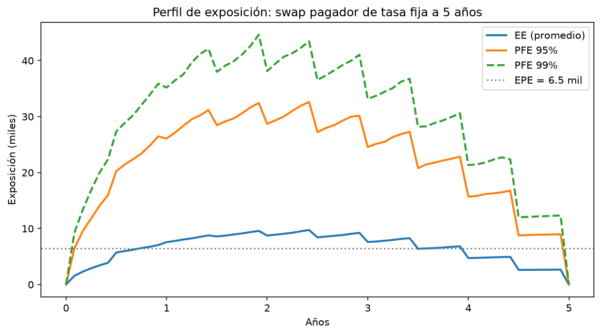
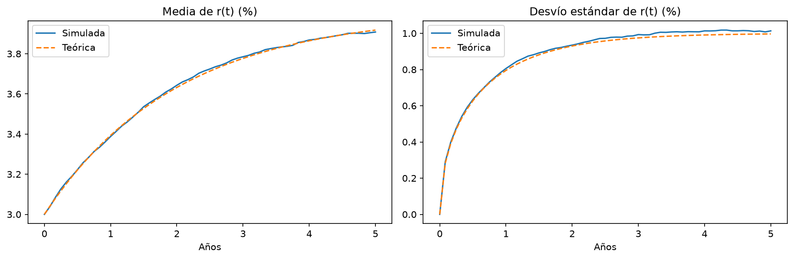

# Counterparty Credit Risk – Exposure Simulation

> 🚧 **Work in progress.** Built step by step; results are added as each stage is validated.

## Objective

Estimate the **counterparty credit exposure** of an interest rate swap portfolio with Monte Carlo simulation: how much a counterparty could owe us in the future if it defaults.

The project builds the full pipeline used in counterparty credit risk (CCR): simulate interest rates, value the swap in every scenario and date, and summarize the exposure distribution with **EE, PFE and EPE**, the inputs for CVA, credit limits and regulatory capital.

## Results so far

**5-year payer swap** (pay fixed, receive floating), semiannual payments, notional 1,000,000, fixed rate set at par (**K = 3.64%**, initial MtM = 0).

| Metric | Value | Used for |
|---|---|---|
| Peak EE | ~9,700 (≈1.0% of notional), around year 2.5 | CVA |
| Peak PFE 95% | ~32,000 (≈3.2% of notional) | Credit limits |
| Peak PFE 99% | ~45,000 | Credit limits |
| EPE | ~6,500 | Regulatory capital |



- **Hump-shaped profile:** exposure grows as rates diffuse away from today's level, peaks around mid-life, and falls as fewer payments remain (amortization effect).
- **Drops every six months:** each coupon payment removes a cash flow from future exposure.
- **Direction matters:** rates are expected to rise in the model (3% → 4%), so the payer swap has roughly twice the expected exposure of the opposite (receiver) swap.

## Methodology

| Stage | Notebook | Status |
|---|---|---|
| Short-rate simulation (Vasicek) and validation | `01_rate_simulation.ipynb` | ✅ |
| Swap valuation in every scenario | `02_swap_valuation.ipynb` | ✅ |
| Exposure profile: EE, PFE, EPE | `03_exposure_profile.ipynb` | ✅ |
| Netting across a swap portfolio | `04_netting.ipynb` | ⬜ |
| Collateral: variation margin, threshold, MPOR | `05_collateral.ipynb` | ⬜ |
| Stress testing | `06_stress.ipynb` | ⬜ |

### Interest rate model: Vasicek

$$dr = a\,(b - r)\,dt + \sigma\,dW$$

Mean-reverting short rate (r0 = 3%, b = 4%, a = 0.5, σ = 1%), 10,000 paths with monthly steps over 5 years. The simulated mean and standard deviation match Vasicek's closed-form moments, and zero-coupon bond prices use the model's closed-form solution.



### Assumptions and limitations

- Normal short rate: rates can turn negative and tails are thin.
- One-factor model: the whole curve moves together (no changes in slope).
- Constant parameters, not calibrated to market data.
- Euler discretization slightly overstates the variance (~1%); exact simulation is a possible improvement.

## Repository structure

```
counterparty-exposure/
├── src/
│   ├── rates.py        # Vasicek simulation and bond prices
│   ├── swap.py         # swap valuation (par rate, MtM)
│   └── exposure.py     # EE, PFE, EPE
├── notebooks/          # analysis, step by step
└── reports/figures/    # charts used in this README
```

Reusable functions live in `src/`; notebooks only call them.

## Author

**Ramiro López** · Actuarial Science, University of Buenos Aires · ramalopez1510@gmail.com
